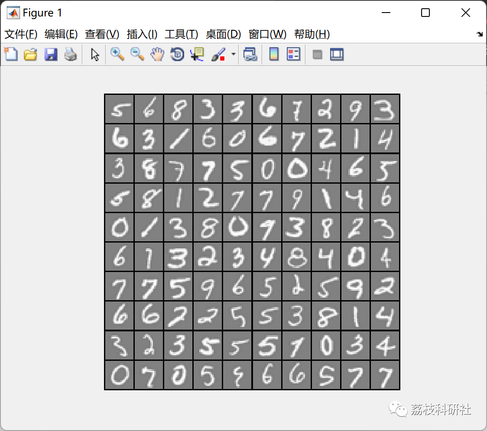
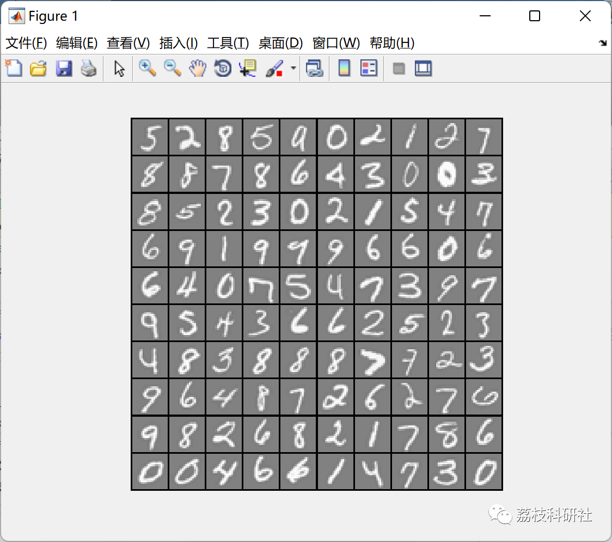

# Identification of handwritten digits (from 0 to 9) using Logistic Regression and Neural Networks (Matlab code implementation)

💥💥💥💞💞💞 Welcome to this blog❤️❤️❤️💥💥💥
🏆 Bloggers' Advantages: 🌞🌞🌞 The content of the blog strives for rigorous thinking and clear logic to facilitate readers.
⛳️ Mantra: A journey of a thousand miles is begun with a single step.
Litchi Research Society
Code Collection: Power Systems, Intelligent Algorithms and Applications, Neural Network Prediction, Path Planning, Optimized Scheduling, Workshop Scheduling, Image Processing, Signal Processing, etc.
🎁 Special Section Links:
🌈🌈🌈🌟🌟🌟🌟 Electrical Code Intelligent Algorithms and Their Applications Path Planning Neural Network Prediction Optimized Scheduling Image Processing Workshop Scheduling Signal Processing Romantic Her Thoughts Math Modeling Complete Code Matters
💥1 Overview
Artificial Neural Networks (ANNs) also known as neural networks (NNs) or connection models, are algorithms and mathematical models that mimic the behavior characteristics of animal neural networks for distributed parallel information processing. These networks rely on the complexity of the system to adjust the connections between numerous nodes internally, thereby achieving the purpose of processing information.
In short, it is a biological neuron that can accept many inputs, not just one. The dendrites collect these electrical signals and combine them into stronger signals. If the signal is strong enough to exceed the threshold, the neuron will fire, along the axon, to the terminal, transmitting the signal to the next neuron's dendrite.
The input value range is from 0-255, in order to avoid oversaturation caused by large input signals, normalization is needed for each pixel. The simplest normalization process is to divide each pixel by 255, turning the pixel into a number between 0.01-1. Therefore, the input values of the neural network model are 784 numbers between 0.01-1, while the output values are 10 numbers between 0-9 after algorithmic model judgment.
📚2 Running Results
🎉3 References
[1] Shi Li, Cai Lin. Research on Constructing Neural Networks Based on Python for Recognizing Handwritten Numbers [J]. Computer Programming Techniques and Maintenance, 2021(2):117-118130
🌈4 Matlab Code Implementation
Click the "Read More" button at the bottom left corner of the article.

## Images

<!-- PAYMENT_BLOCK -->

## Get this dataset

- Payment link (Stripe): [Buy now](https://buy.stripe.com/3cs8yP7sY87d0vu9AB)
- Payment QR code: 

<!-- /PAYMENT_BLOCK -->
